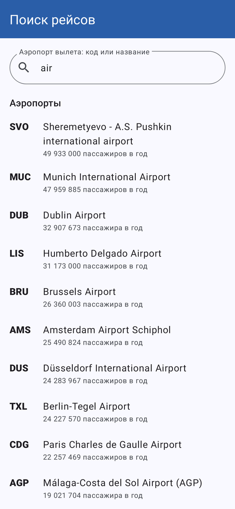
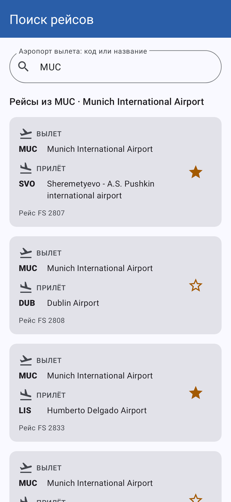
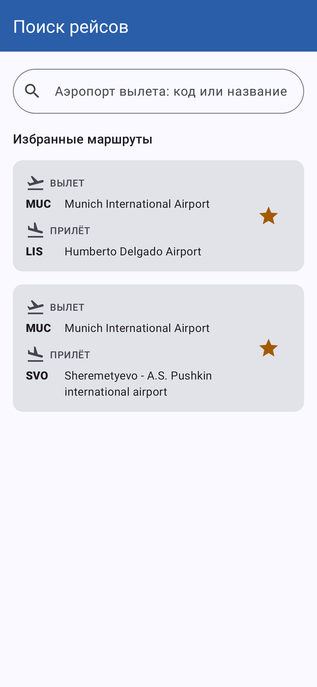

# Поиск рейсов

Лабораторная работа № 5 «Поиск рейсов»: приложение ищет аэропорты в учебной базе `flight_search.db` и показывает рейсы из выбранного аэропорта. Разметка на XML, данные — Room и Preferences DataStore.

## Что умеет

- Поле поиска подсказывает аэропорты по коду IATA или части названия, самые загруженные (по числу пассажиров) стоят выше.
- После выбора подсказки или кнопки «Найти» на клавиатуре открывается список рейсов во все остальные аэропорты базы: коды, названия, номер рейса.
- Звёздочка в карточке добавляет маршрут в избранное или убирает его, запись сразу попадает в таблицу `favorite`.
- Пока поле пустое, на экране список избранных маршрутов, удалить маршрут можно прямо из него.
- Последний выбранный аэропорт хранится в DataStore: при следующем запуске поле заполняется само и рейсы показываются без повторного поиска.
- Пустой результат и ошибка чтения базы показываются отдельным сообщением.
- Интерфейс на русском и английском, есть тёмная тема, на широком экране карточки идут в две колонки.

## Как устроено

| Слой | Что внутри |
|---|---|
| `data` | Room: `AirportEntity`, `FavoriteEntity`, `AirportDao`, `FavoriteDao`, `FlightDatabase` (создаётся из `assets/database/flight_search.db`); `OfflineFlightRepository`; `SearchPreferencesRepository` на DataStore; контейнер зависимостей `DefaultAppContainer` |
| `domain` | модели `Airport`, `Flight`, `FavoriteRoute`, `DepartureBoard`; интерфейсы `FlightRepository`, `SearchQueryRepository`; сценарии `SearchAirportsUseCase`, `GetDepartureBoardUseCase`, `GetFavoriteRoutesUseCase`, `ToggleFavoriteUseCase`, `RemoveFavoriteUseCase` |
| `ui` | `FlightSearchViewModel` (состояние экрана в `StateFlow`), `FlightSearchViewModelFactory`, адаптеры и `ViewHolder` для RecyclerView; `MainActivity` только показывает состояние и передаёт действия во ViewModel |

Запросы к базе и DataStore выполняются в корутинах. Списки получают данные через `Flow`, поэтому звёздочки и список избранного обновляются сами, когда меняется таблица `favorite`. Подсказки ищутся запросом `LIKE` прямо в базе, целиком таблицы в память не читаются.

## Запуск

Открыть папку проекта в Android Studio и запустить конфигурацию `app` (minSdk 24, targetSdk 36). Юнит-тесты ViewModel: `gradlew testDebugUnitTest`.

## Экраны

| Пустое избранное | Подсказки | Рейсы из MUC | Избранное |
|---|---|---|---|
|  |  |  |  |
